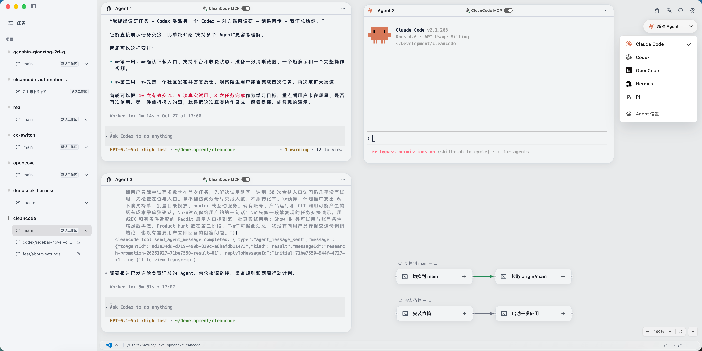
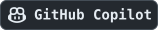
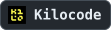
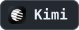
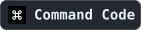
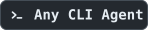
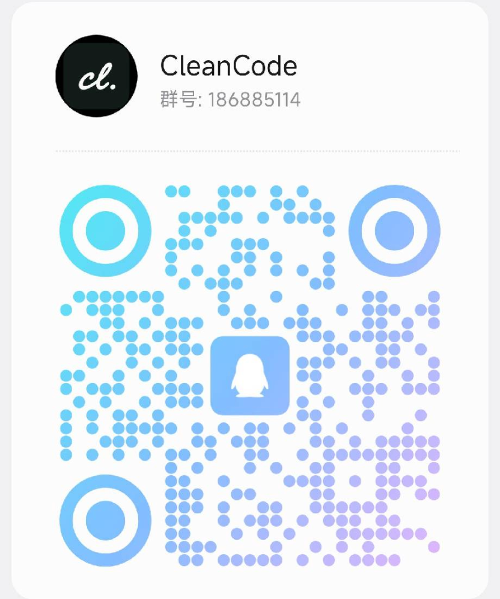

<h1 align="center">
   CleanCode
</h1>

<p align="center">
  <a href="https://github.com/chen-985211/cleancode/releases"></a>
  <a href="./docs/contexts/agent/cleancode-mcp.md"></a>
  <a href="#core-features"></a>
  <a href="./LICENSE"></a>
</p>

<p align="center">
  <a href="#quick-start"></a>
  <a href="#quick-start"></a>
  <a href="#quick-start"></a>
</p>

<p align="center">
  <sub><a href="./README_ZH.md">简体中文</a> · <a href="./README_ZH_TW.md">繁體中文</a> · <a href="./README.md">English</a> · <a href="./README_KO.md">한국어</a> · <strong>日本語</strong></sub>
</p>

<p align="center">
  <strong>人と AI の協働のためのキャンバス型 ADE。ツールの学習や操作の複雑さを AI が担い、人は目標、判断、直感的な操作に集中できます。</strong><br />
  ひとつのキャンバスで Agent と共に作業を進め、進捗を確認しながら必要なときに直接調整できます。
</p>

<h3 align="center"><a href="https://github.com/chen-985211/cleancode/releases"><ins>CleanCode Preview をダウンロード（macOS / Windows / Linux）</ins></a></h3>

<p align="center"></p>
<p align="center"><sub>ひとつのブランチワークスペースに複数の Agent と接続されたターミナルタスクを集約。</sub></p>
<p align="center"><strong>▶ マルチ Agent 協働デモ（0:39）</strong></p>

https://github.com/user-attachments/assets/9e157258-5604-4da6-83f9-65943c19efc5

<p align="center"><strong>▶ 完全版デモ（2:33、音声あり）</strong></p>

https://github.com/user-attachments/assets/cafe373f-97b7-4f8c-b4a4-dfbc88ab26c3

---

## 🧩 CleanCode とは？

**CleanCode は、人と AI の協働のためのキャンバス型 ADE（Agentic Development Environment）です。** Agent、ターミナル、プロジェクトワークスペースをひとつのキャンバスにまとめ、意図を伝え、直接操作しながら、Agent と共に開発や自動化のタスクを進められます。

設計の着想は『ファスト＆スロー』のシステム 1 とシステム 2 にあります。システム 1 は素早く直感的な反応を、システム 2 は集中を要する分析、計画、推論を表します。CleanCode はこの考え方を人と AI の協働に応用し、**人がシステム 1 の仕事を、Agent がシステム 2 の仕事を担います。**

- **人は直感的な表現と直接操作に集中します。** やりたいことや好みを伝え、キャンバス上で観察、選択、調整しながら、目標や判断、重要な意思決定を自ら担います。
- **Agent は分析や計画を要する仕事を担当します。** 利用可能なツールと権限の範囲で、機能の把握、ツールの使い方の学習、タスクの分解、手順の計画、スクリプト作成、コマンド設定、問題の調査、結果の確認を行います。

タスクを終えるには、機能の場所、パラメーターの設定、手順のつながりなど、まずソフトウェアを学ぶ必要があることも少なくありません。CleanCode は、この学習とそれに続く操作を Agent が担うことを目指しています。初めて使う場合も使い慣れた場合も、目標から始めて結果に集中し、いつでも直接操作できます。

<a id="core-features"></a>

## ✨ 主な機能

- 🖼️ **キャンバスワークベンチ**：Agent、ターミナル、グループをひとつのキャンバスに配置し、重ねる、展開する、グリッドに並べる、自動整理する操作に対応。
- 🤖 **複数 Agent 対応**：Codex や Claude Code を含む 33 種類の Agent CLI を使用できます。一部のツールは応答完了、入力待ち、承認待ちを通知します。
- 🤝 **ネイティブ Agent 協働**：CleanCode MCP を通じて Agent がキャンバスを操作し、ワークフローを構築し、別の Agent を作成してタスクを割り当てます。
- 🌿 **ブランチワークスペース**：Git worktree で複数の変更を並行して進め、ブランチごとに独立したキャンバス、ターミナル、Agent セッションを利用できます。
- 📝 **Issue 駆動開発**：GitHub Issues を閲覧し、Issue に紐づくブランチワークスペースを作成または開きます。
- 🧰 **ワークスペースのプリセット**：プロジェクトの既定 Agent とターミナルテンプレートを設定し、新しいブランチワークスペースに自動追加して、必要に応じて実行できます。
- ⚙️ **自動化ワークフロー**：ターミナルコマンド、スクリプト、非対話型 AI CLI を接続し、依存関係に従って実行して各ステップの状態を確認できます。
- 🔌 **ポート管理**：並行して動くサービスに固定ポート、優先ポート、または自動割り当てポートを設定し、実際のアドレスを確認できます。
- 📦 **テンプレートとクイック実行**：よく使うターミナル、ワークフロー、グループをテンプレートに保存し、ショートカットキーでタスクを起動できます。

詳しくは[製品機能とクイックスタート](./docs/product/feature-guide.md)をご覧ください。

<details open>
<summary>Agent の一覧を見る</summary>

CleanCode はターミナルを基盤とし、**33 種類の Coding Agent** の起動設定を内蔵しています。マシンにインストールされたツールを自動検出し、現在のワークスペースで利用できます。

ほかのコマンドライン Agent も、使い慣れたツールや設定のままキャンバスのターミナルで直接実行できます。

<p>
  <a href="https://docs.anthropic.com/claude/docs/claude-code"></a>
  <a href="https://developers.openai.com/codex/cli/"></a>
  <a href="https://opencode.ai/docs/cli/"></a>
  <a href="https://github.com/google-gemini/gemini-cli"></a>
  <a href="https://cursor.com/cli"></a>
  <a href="https://docs.github.com/en/copilot/how-tos/set-up/install-copilot-cli"></a>
  <a href="https://github.com/openclaw/openclaw"></a>
  <a href="https://hermes-agent.nousresearch.com/docs/"></a>
  <a href="https://pi.dev"></a>
  <a href="https://docs.cline.bot/cline-cli/overview"></a>
  <a href="https://block.github.io/goose/docs/quickstart/"></a>
  <a href="https://aider.chat/docs/"></a>
  <a href="https://docs.continue.dev/guides/cli"></a>
  <a href="https://github.com/charmbracelet/crush"></a>
  <a href="https://kilo.ai/docs/cli"></a>
  <a href="https://github.com/QwenLM/qwen-code"></a>
  <a href="https://www.kimi.com/code/docs/en/kimi-code-cli/getting-started.html"></a>
  <a href="https://ampcode.com/manual#install"></a>
  <a href="https://x.ai/cli"></a>
  <a href="https://docs.factory.ai/cli/getting-started/quickstart"></a>
  <a href="https://antigravity.google/docs/cli-overview"></a>
  <a href="https://kiro.dev/docs/cli/"></a>
  <a href="https://github.com/mistralai/mistral-vibe"></a>
  <a href="https://mimo.xiaomi.com/coder"></a>
  <a href="https://openclaude.gitlawb.com/"></a>
  <a href="https://omp.sh"></a>
  <a href="https://devin.ai/cli"></a>
  <a href="https://docs.augmentcode.com/cli/overview"></a>
  <a href="https://www.codebuff.com/docs/help/quick-start"></a>
  <a href="https://github.com/autohandai/code-cli"></a>
  <a href="https://commandcode.ai/docs/quickstart"></a>
  <a href="https://github.com/AntigmaLabs/ante-preview"></a>
  <a href="https://support.atlassian.com/rovo/docs/install-and-run-rovo-dev-cli-on-your-device/"></a>
  
</p>

**使い慣れた Agent をそのまま使い、ひとつのキャンバスで協働できます。**

</details>

<a id="quick-start"></a>

## 🚀 クイックスタート

まず CleanCode を動かしたい場合、すべての概念を理解する必要はありません。以下の手順で始められます。

### Preview のダウンロード

[GitHub Releases](https://github.com/chen-985211/cleancode/releases) から、お使いのプラットフォームに対応するインストーラーをダウンロードしてください。

- macOS：Apple Silicon と Intel の両方に対応する Universal DMG/ZIP。
- Windows：x64 NSIS インストーラー。
- Linux：x64 AppImage/DEB。

> [!WARNING]
> 現在の Preview は正式な開発者証明書で署名されていません。このリポジトリの GitHub Releases からのみダウンロードし、同じリリースの `SHA256SUMS.txt` でパッケージを検証してください。

アプリの Developer ID 署名と Apple notarization がまだ完了していないため、macOS は初回起動をブロックします。`CleanCode.app` を `/Applications` に移動し、入手元と SHA-256 チェックサムを確認した後、このアプリだけのダウンロード隔離属性を削除して起動できます。

```bash
xattr -dr com.apple.quarantine /Applications/CleanCode.app
open /Applications/CleanCode.app
```

このコマンドは、当該アプリの初回 Gatekeeper チェックを回避します。対象を `/Applications`、ダウンロードフォルダー、ホームディレクトリなどの広いパスに置き換えないでください。または [Apple の公式案内](https://support.apple.com/en-asia/102445)に従い、**システム設定 → プライバシーとセキュリティ**で **このまま開く**を選択できます。

### ソースからの開発に必要な環境

以下の要件は、ソースから実行する場合や開発に参加する場合にのみ適用されます。Preview のダウンロード前に開発用依存関係をインストールする必要はありません。

- Node.js `>= 24`
- pnpm `>= 10`
- macOS、Windows、または Linux

### ローカルで実行

```bash
git clone https://github.com/chen-985211/cleancode.git
cd cleancode
pnpm install
pnpm dev
```

### よく使うチェック

```bash
pnpm typecheck
pnpm test
pnpm pre-commit
```

### ローカルでビルド

```bash
# ローカル検証用の、現在のプラットフォーム向け未パッケージアプリ
pnpm package

# 現在のプラットフォーム向け配布インストーラー
pnpm dist

# 対応する OS 上で対象を明示的に選択することもできます
pnpm dist:mac
pnpm dist:win
pnpm dist:linux
```

ビルド成果物は `release/` に出力されます。

## 📚 ドキュメント

- [製品機能とクイックスタート](./docs/product/feature-guide.md)
- [ドキュメントセンター](./docs/README.md)
- [アーキテクチャガイド](./docs/engineering/architecture.md)
- [コンテキストマップ](./docs/engineering/context-map.md)
- [UI 契約](./docs/product/ui-contract.md)
- [ターミナルの依存ワークフロー](./docs/contexts/run/terminal-workflow.md)
- [Agent とセッションのライフサイクル](./docs/contexts/agent/agent-session.md)
- [CleanCode ネイティブ MCP](./docs/contexts/agent/cleancode-mcp.md)
- [開発協働ガイドライン](./docs/engineering/development.md)

## 🤝 コントリビュート

Issue、ディスカッション、Pull Request を歓迎します。始める前に[コントリビューションガイド](./CONTRIBUTING.md)と[開発協働ガイドライン](./docs/engineering/development.md)をお読みください。

## 💬 コミュニティに参加

下の QR コードを読み取って CleanCode コミュニティに参加し、アイデアや機能の提案、問題の報告をお寄せください。

<p align="center"></p>
<p align="center"><strong>グループ番号：186885114</strong><br /><sub>人と AI の協働を通じて、AI ネイティブ OS の可能性を探ります。</sub></p>
